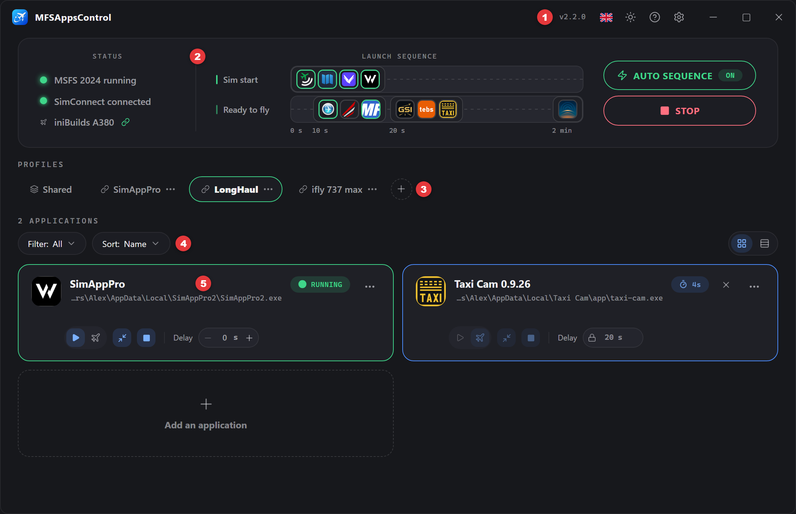
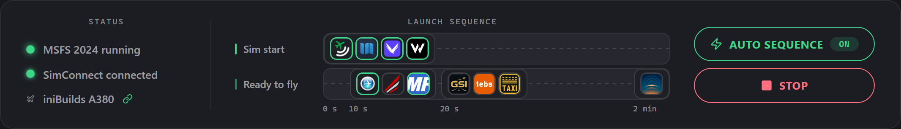
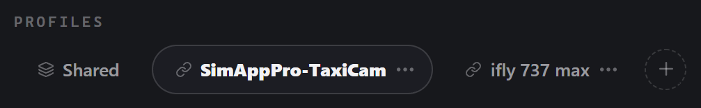
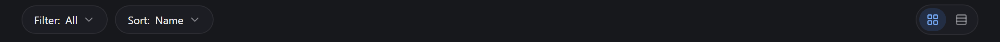
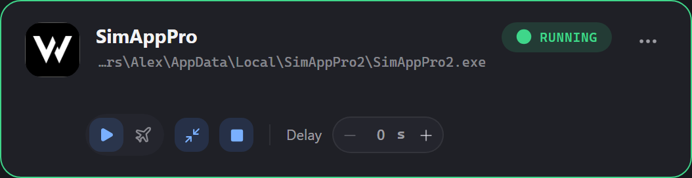

# Primeros pasos

MFSAppsControl se basa en una sola idea: 
Gestionar las aplicaciones que hay que iniciar y/o detener con tu simulador sin tener que pensar en ello.

---

## La pantalla principal

### 1. La barra de título

A la izquierda, el logotipo con el nombre de la aplicación. 
A la derecha, de izquierda a derecha:

- la **versión** (vX.Y.Z),
- el idioma (:flag_gb:),
- el **tema** (:material-weather-sunny:),
- la **ayuda** (:material-help-circle:),
- las **opciones** (:material-cog:),
- y los botones de gestión de la ventana (:material-window-minimize:, :material-window-maximize:, :material-window-close:).

Cuando hay una nueva versión disponible, aparece una **insignia** junto a la versión. Un clic en ella inicia la descarga y la instalación.

### 2. El panel de estado y secuencia

Es la representación visual de:

- el estado del simulador y de la conexión SimConnect, y el avión cargado,
- la secuencia de inicio de las aplicaciones,
- el interruptor de la secuencia automática y el botón de prueba de la secuencia.

**A la izquierda, los estados** — MFS, SimConnect y el avión. 

- Estado de MFS

  | Punto                                            | Etiqueta                             | Descripción                                 |
  | ------------------------------------------------ | ------------------------------------ | ------------------------------------------- |
  | :material-circle:{ style="color:#8a8f98" } gris  | **MSFS detenido**                    | El simulador no está iniciado ni detectado. |
  | :material-circle:{ style="color:#4a9eff" } azul  | **Iniciando los addons…**            | Se ha detectado el proceso del simulador.   |
  | :material-circle:{ style="color:#3ecf8e" } verde | **MSFS 2024 en ejecución** | El simulador está en ejecución (2024 o 2020). Pasa el ratón por encima para ver su proceso y su PID. |

- Estado de SimConnect

  | Punto                                            | Etiqueta                     | Descripción                                          |
  | ------------------------------------------------ | ---------------------------- | ---------------------------------------------------- |
  | :material-circle:{ style="color:#8a8f98" } gris  | **SimConnect desconectado**  | A la espera de que se inicie el simulador.           |
  | :material-circle:{ style="color:#3ecf8e" } verde | **SimConnect conectado**     | Conexión establecida, sistema listo.                 |
  | :material-circle:{ style="color:#ff5c5c" } rojo  | **SimConnect no disponible** | SimConnect no responde (consulta la [FAQ](faq.md)). |

- Avión

  El avión cargado en el simulador, en cuanto SimConnect lo anuncia — también en el menú principal, mientras recorres los aviones. Un icono :material-link-variant:{ style="color:#3ecf8e" } indica que está vinculado a un perfil, un icono :material-link-variant-off: que no lo está: haz clic en su nombre para vincularlo o desvincularlo. Mientras no se anuncia ningún avión, la línea solo muestra el icono :material-airplane:. → [Perfiles vinculados a aviones](profiles.md#perfiles-vinculados-a-aviones)

Fuera de una sesión solo se muestra la línea de MSFS: SimConnect y el avión solo tienen sentido mientras el simulador está en ejecución, y sus líneas vuelven con él.

**En el centro, la secuencia de inicio** 
La línea de tiempo de tus aplicaciones, representadas por sus iconos sobre sus retardos de inicio (visible solo si hay al menos una aplicación configurada). → [El detalle de la línea de tiempo](applications.md#la-linea-de-tiempo)

**A la derecha, el interruptor Secuencia auto y el botón Probar/Detener** 
**Secuencia auto**, arriba, activa o desactiva la secuencia automática. Desactivada, no se inicia ni se detiene nada con el simulador, y el icono del área de notificación lleva un punto rojo; activada, el punto sigue la secuencia (→ [Siempre listo](#siempre-listo)). El menú del icono ofrece el mismo interruptor, y la elección se conserva al reiniciar. El botón indica **ON** u **OFF**. 
  
**Probar**, debajo, simula el inicio y el cierre de MSFS para probar tus secuencias sin iniciar MSFS. Durante un vuelo o una prueba, se convierte en **Detener**. → [Probar la secuencia](applications.md#probar-la-secuencia)

Durante un vuelo real, **Detener** enumera primero las aplicaciones que va a cerrar y te pide confirmación; la sesión continúa hasta que cierras MSFS.

### 3. Los perfiles

Muestra todos tus perfiles disponibles, con el perfil activo resaltado.

Un botón para **crear** un nuevo perfil. 
Puedes reordenarlos arrastrando las pestañas. 
El menú **:material-dots-horizontal:** permite renombrarlos, duplicarlos o eliminarlos. → [Perfiles](profiles.md)

La pestaña **Compartido**, siempre la primera, contiene las aplicaciones que se inician con todos los perfiles; un icono :material-link-variant: señala un perfil vinculado a aviones.

### 4. Los filtros

Muestra el número de aplicaciones y permite filtrar y ordenar las aplicaciones de la lista.

- **Filtrar**: Todas / Inicio de MSFS / Cierre de MSFS / Listo para volar
- **Ordenar**: Nombre / Retardo

Estos ajustes solo afectan a la visualización.

A la derecha, :material-view-grid-outline: **Tarjetas** y :material-view-agenda-outline: **Lista compacta** eligen cómo se muestran las aplicaciones. La elección se conserva entre reinicios. 
Mientras un perfil no tenga ninguna aplicación, esta barra solo muestra el recuento.

### 5. Las aplicaciones

Se representan mediante **tarjetas**, una por cada aplicación configurada.

Una **tarjeta** muestra la información de la aplicación y su configuración. → [Anatomía de una tarjeta](applications.md#anatomia-de-una-tarjeta)

En la pestaña **Compartido**, las tarjetas se reparten en dos bloques, **Con MSFS abierto** y **Con MSFS cerrado**. → [Aplicaciones con MSFS cerrado](applications.md#aplicaciones-con-msfs-cerrado)

---

## Tu primera configuración

### 1. El perfil predeterminado

En el primer inicio te espera un **perfil predeterminado**, vacío. 
Úsalo tal cual, renómbralo y crea otros según tus necesidades. → [Perfiles](profiles.md)

### 2. Añade una aplicación

Haz clic en la tarjeta **Añadir una aplicación**. 
Elige la aplicación → [Añadir una aplicación](applications.md#anadir-una-aplicacion):

- En la lista de **Aplicaciones instaladas**
- O mediante la ruta de su `.exe` con **Examinar…**

### 3. Define sus opciones de control

Es el ajuste más importante. En la ventana de añadir, la línea **Disparador** ofrece:

- **Inicio del sim** :material-play: para iniciarla con el simulador (MobiFlight, Navigraph…).
- **Listo para volar** :material-airplane: para iniciarla ya dentro del avión (REX Atmos, vPilot…).

Ninguno de los dos es obligatorio; el botón **Cierre auto** :material-stop: cerrará la aplicación junto con el simulador. (Se activa automáticamente si la aplicación se inicia en modo «Listo para volar»)

### 4. Ajusta el retardo

El **retardo** permite retrasar el inicio a partir del disparador elegido. → [El retardo](applications.md#el-retardo)

### 5. Pruébalo

Haz clic en **Probar**: la secuencia se desarrolla como si el simulador estuviera arrancando. 
Una cuenta atrás **«Listo para volar en 10 s…»** simula la conexión de SimConnect al cabo de 10 s.

Haz clic en **Detener** para terminar la prueba y cerrar las aplicaciones que tengan configurada la opción.

## El desarrollo de un vuelo

| Momento                                             | Lo que hace MFSAppsControl                                                                                                                                     |
| --------------------------------------------------- | -------------------------------------------------------------------------------------------------------------------------------------------------------------- |
| Inicias **MFS**                                     | El estado de MFS pasa a azul. Las aplicaciones del bloque **Con MSFS cerrado** configuradas para cerrarse se cierran. |
| El simulador carga                                  | El estado de MFS pasa a verde, el estado de SimConnect pasa a verde en cuanto está disponible y las aplicaciones de inicio del sim arrancan según su retardo. |
| Llegas a la pantalla **Listo para volar** de un vuelo | La secuencia **Listo para volar** arranca a su vez, con sus propios retardos.                                                                                  |
| Cambias de vuelo                                    | Las aplicaciones **no se reinician**, siguen activas.                                                                                                          |
| Cambias de perfil — a mano, o mediante un [avión vinculado](profiles.md#perfiles-vinculados-a-aviones) | Nada en el momento. Al cargar el siguiente vuelo, las aplicaciones del perfil anterior se cierran y las de inicio del sim del nuevo perfil arrancan enseguida; sus aplicaciones listo para volar siguen en la pantalla Listo para volar. |
| Sales de **MFS**                                    | Todas las aplicaciones configuradas en **Cierre auto** (incluidas las del modo «Listo para volar») se cierran correctamente. Después se inician las del bloque **Con MSFS cerrado** configuradas para iniciarse, tras su retardo. |

!!! info "Si MFS ya está iniciado antes que MFSAppsControl"
    La secuencia **no se dispara**. Se armará en el próximo inicio de MFS. 
    Es un caso complejo en el que no se puede garantizar un lanzamiento correcto sin problemas. 
    Las aplicaciones ya iniciadas se detectarán y se cerrarán correctamente al cerrar el simulador si la opción está activada.  
    **Consejo**: siempre puedes iniciar una aplicación manualmente desde el menú **:material-dots-horizontal:** de su tarjeta o desde fuera.

---

## Siempre listo

Activa **Iniciar al arrancar Windows** e **Iniciar minimizado en la bandeja del sistema** en las [Opciones](options.md). 
Puedes olvidarte de la aplicación o simplemente abrirla para cambiar de perfil antes de tu vuelo.

Su icono muestra de un vistazo lo que está haciendo MFSAppsControl. Pasa el cursor por encima para leer el estado con palabras.

| Icono | Punto | Significado |
| :---: | :---: | --- |
|  | gris | La secuencia automática está activada y espera: al simulador, o ya no queda nada por hacer en esta sesión. |
|  | verde | La secuencia ha iniciado algo y aún tiene trabajo en esta sesión: una cuenta atrás, una aplicación «listo para volar» que espera el vuelo, o una aplicación que cerrar con el simulador. |
|  | naranja | No se pudo iniciar una aplicación, o SimConnect no responde. → [Solución de problemas](faq.md) |
|  | rojo | La secuencia automática está desactivada: no se inicia ni se detiene nada con el simulador. |
