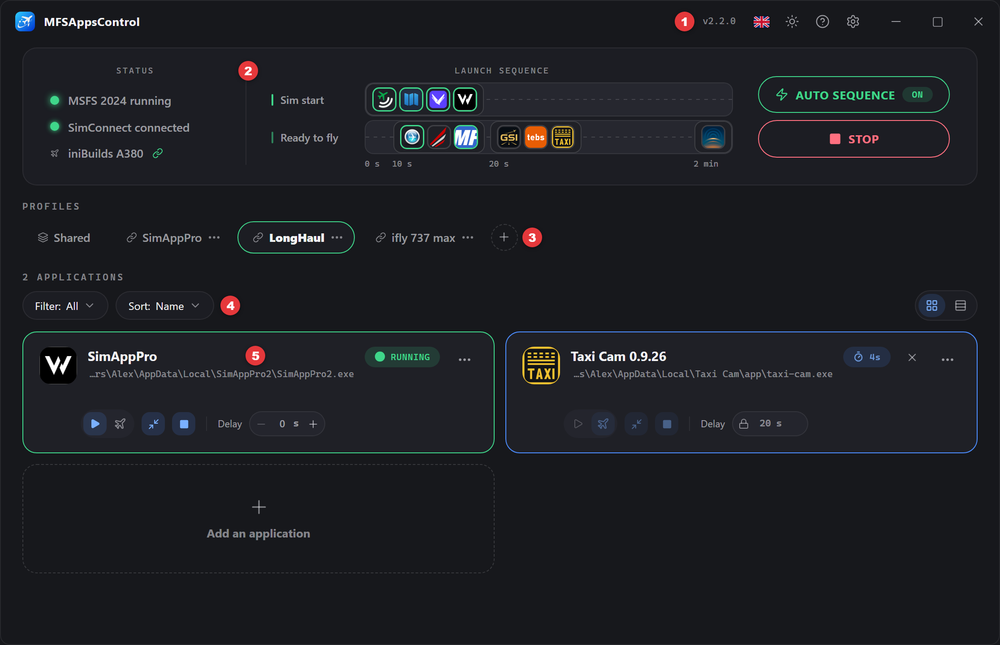
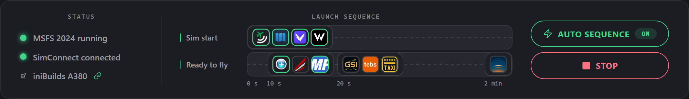
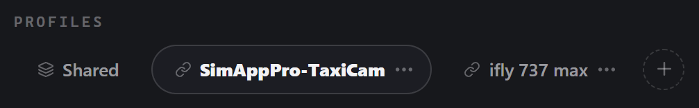
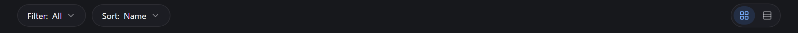
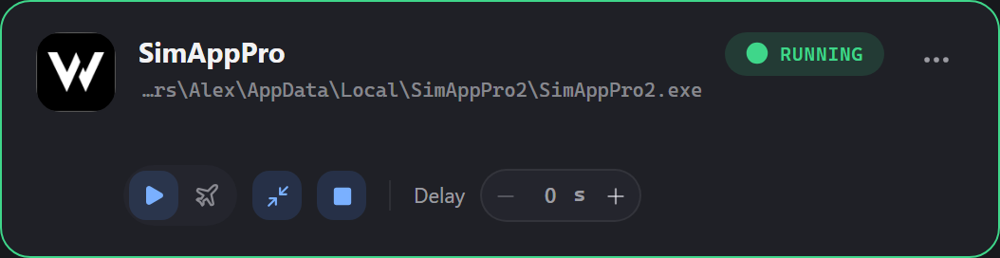

# Prise en main

MFSAppsControl repose sur une seule idée : 
Gérer les applications à démarrer et/ou arrêter avec votre simulateur sans devoir y penser.

---

## L'écran principal

### 1. La barre de titre

A gauche, le logo avec le nom de l'application. 
A droite de gauche à droite : 

- la **version** (vX.Y.Z),
- la langue (:flag_gb:),
- le **thème** (:material-weather-sunny:),
- l'**aide** (:material-help-circle:),
- les **options** (:material-cog:),
- et les boutons de gestion de la fenêtre (:material-window-minimize:, :material-window-maximize:, :material-window-close:).

Quand une nouvelle version est disponible, un **badge** apparaît à côté de la version. Un clic dessus lance le téléchargement et l'installation.

### 2. Le bandeau de statut & séquence

C'est l'affichage visuel de :

- l'état du simulateur et de la connexion SimConnect, et l'avion chargé,
- la séquence de lancement des applications,
- l'interrupteur de séquence automatique et le bouton de test de la séquence.

**À gauche, les statuts** — MFS, SimConnect et l'avion. 

- Statut MFS

  | Bulle                                            | Libellé                              | Description                                    |
  | ------------------------------------------------ | ------------------------------------ | ---------------------------------------------- |
  | :material-circle:{ style="color:#8a8f98" } grise | **MFS arrêté**                       | Le simulateur n'est pas lancé/détecté.         |
  | :material-circle:{ style="color:#4a9eff" } bleue | **Lancement des applications…**      | Le processus du simulateur est détecté.        |
  | :material-circle:{ style="color:#3ecf8e" } verte | **MSFS 2024 lancé** | Le simulateur tourne (2024 ou 2020). Survolez-le pour son processus et son PID. |

- Statut SimConnect

  | Bulle                                            | Libellé                     | Description                                       |
  | ------------------------------------------------ | --------------------------- | ------------------------------------------------- |
  | :material-circle:{ style="color:#8a8f98" } grise | **SimConnect déconnecté**   | En attente de lancement du simulateur.            |
  | :material-circle:{ style="color:#3ecf8e" } verte | **SimConnect connecté**     | Connexion établie, système prêt.                  |
  | :material-circle:{ style="color:#ff5c5c" } rouge | **SimConnect indisponible** | SimConnect ne répond pas (voir la [FAQ](faq.md)). |

- Avion

  L'avion chargé dans le simulateur, dès que SimConnect l'annonce — au menu principal aussi, pendant que vous parcourez les avions. Une icône :material-link-variant:{ style="color:#3ecf8e" } indique qu'il est lié à un profil, une icône :material-link-variant-off: qu'il ne l'est pas : cliquez sur son nom pour le lier ou le délier. Tant qu'aucun avion n'est annoncé, la ligne ne montre que l'icône :material-airplane:. → [Profils liés aux avions](profiles.md#profils-lies-aux-avions)

Hors session, seule la ligne MSFS s'affiche : SimConnect et l'avion n'ont de sens que pendant que le simulateur tourne, et leurs lignes reviennent avec lui.

**Au centre, la séquence de lancement** 
La timeline de vos applications représentées par leurs icônes, sur les délais de démarrage (visible uniquement si au moins une application est configurée). → [Le détail de la timeline](applications.md#la-timeline)

**À droite, l'interrupteur Séquence auto et le bouton Tester/Arrêter** 
**Séquence auto**, en haut, active ou désactive la séquence automatique. Désactivée, rien n'est lancé ni arrêté avec le simulateur, et l'icône de la zone de notification porte une pastille rouge ; activée, sa pastille suit la séquence (→ [Toujours prêt](#toujours-pret)). Le menu de l'icône propose le même interrupteur, et le choix est conservé au redémarrage. Le bouton indique **ON** ou **OFF**. 
  
**Tester**, en dessous, simule le démarrage et l'arrêt de MSFS pour tester vos séquences sans lancer MSFS. Pendant un vol ou un test, il devient **Arrêter**. → [Tester la séquence](applications.md#tester-la-sequence)

Pendant un vrai vol, **Arrêter** liste d'abord les applications qu'il va fermer et vous demande de confirmer ; la session continue jusqu'à ce que vous quittiez MSFS.

### 3. Les profils

Affiche l'ensemble de vos profils disponibles, avec le profil actif mis en évidence.

Un bouton pour **créer** un nouveau profil. 
Ils peuvent être réorganisés en glissant les onglets. 
Le menu **:material-dots-horizontal:** permet de les renommer/dupliquer/supprimer. → [Profils](profiles.md)

L'onglet **Partagé**, toujours en premier, contient les applications lancées avec tous les profils ; une icône :material-link-variant: signale un profil lié à des avions.

### 4. Les filtres

Affiche le nombre d'applications et permet de filtrer et trier les applications de la liste.

- **Filtrer** : Toutes / Démarrage MFS / Arrêt MFS / Prêt à voler
- **Trier** Nom / Délai

Ces réglages n'affectent que l'affichage.

À droite, :material-view-grid-outline: **Cartes** et :material-view-agenda-outline: **Liste compacte** choisissent l'affichage des applications. Le choix est conservé d'un lancement à l'autre. 
Tant qu'un profil n'a aucune application, cette barre n'affiche que le compte.

### 5. Les applications

Représentées par des **cartes** pour chaque application configurée.

Une **carte** affiche les informations de l'application et sa configuration. → [Anatomie d'une carte](applications.md#anatomie-dune-carte)

Dans l'onglet **Partagé**, les cartes se répartissent en deux blocs, **Quand MSFS est ouvert** et **Quand MSFS est fermé**. → [Applications quand MSFS est fermé](applications.md#applications-quand-msfs-est-ferme)

---

## Votre première configuration

### 1. Le profil par défaut

Au premier lancement, un **profil par défaut** vous attend, vide. 
Utilisez-le tel quel, renommez-le, et créez-en d'autres selon vos besoins. → [Profils](profiles.md)

### 2. Ajoutez une application

Cliquez sur la carte **Ajouter une application**. 
Choisissez l'application→ [Ajouter une application](applications.md#ajouter-une-application) :

- Dans la liste des **applications installées**
- Ou par le chemin de son `.exe` via **Parcourir**

### 3. Définissez ses options de contrôle

C'est le réglage le plus important. Dans la fenêtre d'ajout, la ligne **Déclencheur** propose :

- **Démarrage sim** :material-play: pour la lancer avec le simulateur (MobiFlight, Navigraph…).
- **Prêt à voler** :material-airplane: pour la lancer en étant dans l'avion. (REX Atmos, vPilot…).

Aucun des deux n'est obligatoire, le bouton **Arrêter** :material-stop: arrêtera l'application avec le simulateur. (Automatiquement activée si l'application est lancée en mode "Prêt à voler")

### 4. Réglez le délai

Le **délai** permet de retarder le démarrage, sur le déclencheur choisi. → [Le délai](applications.md#le-delai)

### 5. Testez

Cliquez sur **Tester** : la séquence se déroule comme si le simulateur démarrait.  
Un compte à rebours **« Prêt à voler dans 10 s… »** simule la connexion SimConnect après 10s.

Cliquez sur **Arrêter** pour arrêter le test et fermer les applications configurées avec l'option.

## Le déroulé d'un vol

| Moment                                             | Ce que fait MFSAppsControl                                                                                                                          |
| -------------------------------------------------- | --------------------------------------------------------------------------------------------------------------------------------------------------- |
| Vous lancez **MFS**                                | Le statut MFS passe au bleu. Les applications du bloc **Quand MSFS est fermé** réglées pour se fermer sont fermées. |
| Le simulateur charge                               | Le statut MFS passe au vert, le statut SimConnect passe au vert dès que disponible et les applications démarrage sim sont lancées selon leur délai. |
| Vous arrivez sur l'écran **Prêt à voler** d'un vol | La séquence **Prêt à voler** démarre à son tour, avec ses propres délais.                                                                           |
| Vous changez de vol                                | Les applications **ne se relancent pas**, elles restent actives.                                                                                    |
| Vous changez de profil — à la main, ou par un [avion lié](profiles.md#profils-lies-aux-avions) | Rien sur le moment. Au chargement du vol suivant, les applications de l'ancien profil se ferment et celles du nouveau profil en démarrage sim partent tout de suite ; ses applications prêt à voler suivent à l'écran Prêt à voler. |
| Vous quittez **MFS**                               | Toutes les applications configurées en **Arrêt auto** (incluant celles liées au mode "Prêt à voler") sont fermées proprement. Puis celles du bloc **Quand MSFS est fermé** réglées pour se lancer démarrent, après leur délai. |

!!! info "Si MFS est déjà démarré avant MFSAppsControl"
    La séquence **ne se déclenche pas** ! Elle s'armera au prochain lancement de MFS. 
    Ce cas est complexe qui ne peut garantir un lancement correct sans problème. 
    Les applications déjà lancées seront détectées et seront fermer proprement à la fermeture du simulateur si l'option est activée.  
    **Astuce** : Vous pouvez toujours lancer une application manuellement via le menu **:material-dots-horizontal:** de sa carte ou en dehors.

---

## Toujours prêt

Activez **Lancer au démarrage de Windows** et **Démarrer dans la zone de notification** dans les [Options](options.md). 
Vous pouvez l'oublier ou simplement l'ouvrir pour changer de profil avant votre vol.

Son icône montre d'un coup d'œil ce que fait MFSAppsControl. Survolez-la pour lire l'état en toutes lettres.

| Icône | Pastille | Signification |
| :---: | :---: | --- |
|  | grise | La séquence automatique est activée et attend : le simulateur, ou il ne reste plus rien à faire dans cette session. |
|  | verte | La séquence a lancé quelque chose et a encore à faire dans cette session : un décompte, une application « prêt à voler » qui attend le vol, ou une application à fermer avec le simulateur. |
|  | orange | Une application n'a pas pu être lancée, ou SimConnect ne répond pas. → [Dépannage](faq.md) |
|  | rouge | La séquence automatique est désactivée : rien n'est lancé ni arrêté avec le simulateur. |
