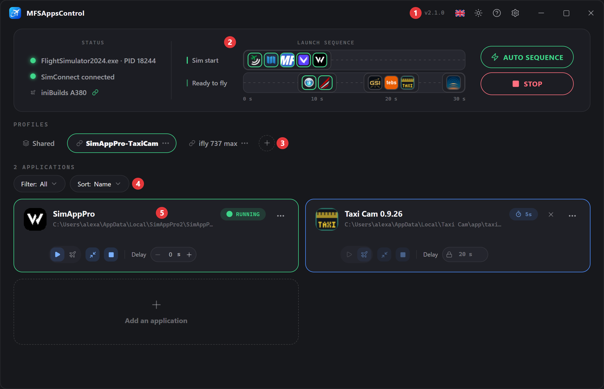
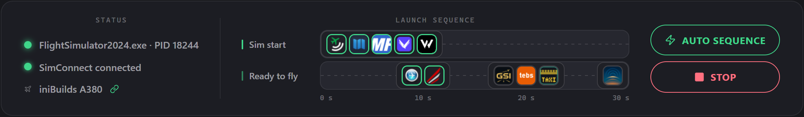
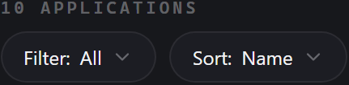
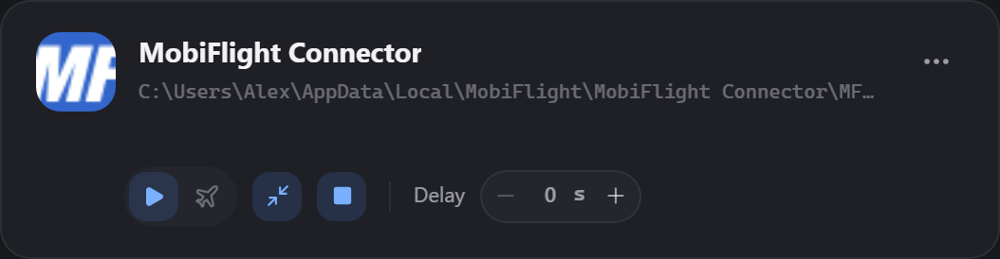

# Introdução

O MFSAppsControl assenta numa única ideia: 
Gerir as aplicações a iniciar e/ou parar com o seu simulador sem ter de pensar nisso.

---

## O ecrã principal

### 1. A barra de título

À esquerda, o logótipo com o nome da aplicação. 
À direita, da esquerda para a direita:

- a **versão** (vX.Y.Z),
- o idioma (:flag_gb:),
- o **tema** (:material-weather-sunny:),
- a **ajuda** (:material-help-circle:),
- as **opções** (:material-cog:),
- e os botões de gestão da janela (:material-window-minimize:, :material-window-maximize:, :material-window-close:).

Quando existe uma nova versão disponível, aparece um **emblema** junto à versão. Um clique inicia a transferência e a instalação.

### 2. O painel de estado e sequência

É a apresentação visual de:

- o estado do simulador e da ligação SimConnect, e a aeronave carregada,
- a sequência de arranque das aplicações,
- o interruptor da sequência automática e o botão de teste da sequência.

**À esquerda, os estados** — MSFS, SimConnect e a aeronave. 

- Estado do MSFS

  | Indicador                                          | Etiqueta                             | Descrição                                    |
  | -------------------------------------------------- | ------------------------------------ | ---------------------------------------------- |
  | :material-circle:{ style="color:#8a8f98" } cinzento | **MSFS parado**                      | O simulador não está iniciado/detetado.        |
  | :material-circle:{ style="color:#4a9eff" } azul     | **A iniciar os addons…**             | O processo do simulador foi detetado.          |
  | :material-circle:{ style="color:#3ecf8e" } verde    | `FlightSimulator2024.exe · PID 1234` | As informações do processo foram recuperadas.  |

- Estado do SimConnect

  | Indicador                                           | Etiqueta                    | Descrição                                          |
  | --------------------------------------------------- | --------------------------- | ------------------------------------------------- |
  | :material-circle:{ style="color:#8a8f98" } cinzento | **SimConnect desligado**    | A aguardar o arranque do simulador.               |
  | :material-circle:{ style="color:#3ecf8e" } verde    | **SimConnect ligado**       | Ligação estabelecida, sistema pronto.             |
  | :material-circle:{ style="color:#ff5c5c" } vermelho | **SimConnect indisponível** | O SimConnect não responde (ver a [FAQ](faq.md)). |

- Aeronave

  A aeronave carregada no simulador, assim que o SimConnect a anuncia — também no menu principal, enquanto percorre as aeronaves. Um ícone :material-link-variant:{ style="color:#3ecf8e" } indica que está vinculada a um perfil, um ícone :material-link-variant-off: que não está: clique no nome para a vincular ou desvincular. Enquanto nenhuma aeronave é anunciada, a linha só mostra o ícone :material-airplane:. → [Perfis vinculados a aeronaves](profiles.md#perfis-vinculados-a-aeronaves)

**Ao centro, a sequência de arranque** 
A linha temporal das suas aplicações, representadas pelos seus ícones, sobre os atrasos de arranque (visível apenas se pelo menos uma aplicação estiver configurada). → [O detalhe da linha temporal](applications.md#a-linha-temporal)

**À direita, o interruptor Sequência auto e o botão Testar/Parar** 
**Sequência auto**, em cima, ativa ou desativa a sequência automática. Desativada, nada é iniciado nem parado com o simulador. O ícone da área de notificação mostra o mesmo estado com um ponto verde ou vermelho, e o seu menu oferece o mesmo interruptor; a escolha mantém-se após reiniciar. 
  
**Testar**, por baixo, simula o arranque e a paragem do MSFS para testar as suas sequências sem iniciar o MSFS. Durante um voo ou um teste, passa a **Parar**. → [Testar a sequência](applications.md#testar-a-sequencia)

### 3. Os perfis

Mostra todos os perfis disponíveis, com o perfil ativo em destaque.

Um botão para **criar** um novo perfil. 
Podem ser reorganizados arrastando os separadores. 
O menu **:material-dots-horizontal:** permite mudar o nome/duplicar/eliminar. → [Perfis](profiles.md)

O separador **Compartilhado**, sempre em primeiro lugar, contém as aplicações iniciadas com todos os perfis; um ícone :material-link-variant: assinala um perfil vinculado a aeronaves.

### 4. Os filtros

Mostra o número de aplicações e permite filtrar e ordenar as aplicações da lista.

- **Filtrar**: Todas / Arranque do MSFS / Encerramento do MSFS / Pronto para voar
- **Ordenar** Nome / Atraso

Estas definições afetam apenas a visualização.

### 5. As aplicações

Representadas por **cartões**, um para cada aplicação configurada.

Um **cartão** apresenta as informações da aplicação e a sua configuração. → [Anatomia de um cartão](applications.md#anatomia-de-um-cartao)

---

## A sua primeira configuração

### 1. O perfil predefinido

No primeiro arranque, um **perfil predefinido** espera por si, vazio. 
Use-o tal como está, mude-lhe o nome e crie outros conforme as suas necessidades. → [Perfis](profiles.md)

### 2. Adicione uma aplicação

Clique no cartão **Adicionar uma aplicação**. 
Escolha a aplicação → [Adicionar uma aplicação](applications.md#adicionar-uma-aplicacao):

- Na lista das **aplicações instaladas**
- Ou pelo caminho do seu `.exe` através de **Procurar**

### 3. Defina as suas opções de controlo

É a definição mais importante. Na janela de adição, a linha **Acionador** propõe:

- **Início do sim** :material-play: para a iniciar com o simulador (MobiFlight, Navigraph…).
- **Pronto para voar** :material-airplane: para a iniciar já dentro do avião. (REX Atmos, vPilot…).

Nenhum dos dois é obrigatório; o botão **Paragem auto** :material-stop: encerra a aplicação com o simulador. (Ativado automaticamente se a aplicação for iniciada no modo "Pronto para voar")

### 4. Defina o atraso

O **atraso** permite adiar o arranque, a partir do acionador escolhido. → [O atraso](applications.md#o-atraso)

### 5. Teste

Clique em **Testar**: a sequência decorre como se o simulador estivesse a arrancar.  
Uma contagem decrescente **«Pronto para voar em 10s…»** simula a ligação SimConnect ao fim de 10 s.

Clique em **Parar** para terminar o teste e fechar as aplicações configuradas com essa opção.

## O desenrolar de um voo

| Momento                                              | O que o MFSAppsControl faz                                                                                                                                                     |
| ---------------------------------------------------- | ------------------------------------------------------------------------------------------------------------------------------------------------------------------------------ |
| Inicia o **MSFS**                                    | O estado do MSFS passa a azul.                                                                                                                                                 |
| O simulador carrega                                  | O estado do MSFS passa a verde, o estado do SimConnect passa a verde assim que estiver disponível e as aplicações de início do sim são iniciadas segundo o respetivo atraso.   |
| Chega ao ecrã **Pronto para voar** de um voo         | A sequência **Pronto para voar** arranca por sua vez, com os seus próprios atrasos.                                                                                            |
| Muda de voo                                          | As aplicações **não voltam a arrancar**, permanecem ativas.                                                                                                                    |
| Muda de perfil — à mão, ou através de uma [aeronave vinculada](profiles.md#perfis-vinculados-a-aeronaves) | Nada no momento. Ao carregar o voo seguinte, as aplicações do perfil anterior fecham-se e as de início do sim do novo perfil arrancam de imediato; as suas aplicações pronto para voar seguem no ecrã Pronto para voar. |
| Sai do **MSFS**                                      | Todas as aplicações configuradas em **Paragem auto** (incluindo as ligadas ao modo "Pronto para voar") são fechadas de forma limpa.                                            |

!!! info "Se o MSFS já estiver iniciado antes do MFSAppsControl"
    A sequência **não é acionada**! Armar-se-á no próximo arranque do MSFS. 
    É um caso complexo, que não permite garantir um arranque correto sem problemas. 
    As aplicações já iniciadas serão detetadas e fechadas de forma limpa ao encerrar o simulador, se a opção estiver ativada.  
    **Dica**: pode sempre iniciar uma aplicação manualmente através do menu **:material-dots-horizontal:** do seu cartão, ou fora da aplicação.

---

## Sempre pronto

Ative **Iniciar no arranque do Windows** e **Iniciar minimizado na bandeja do sistema** nas [Opções](options.md). 
Pode esquecer-se dele ou simplesmente abri-lo para mudar de perfil antes do voo.

