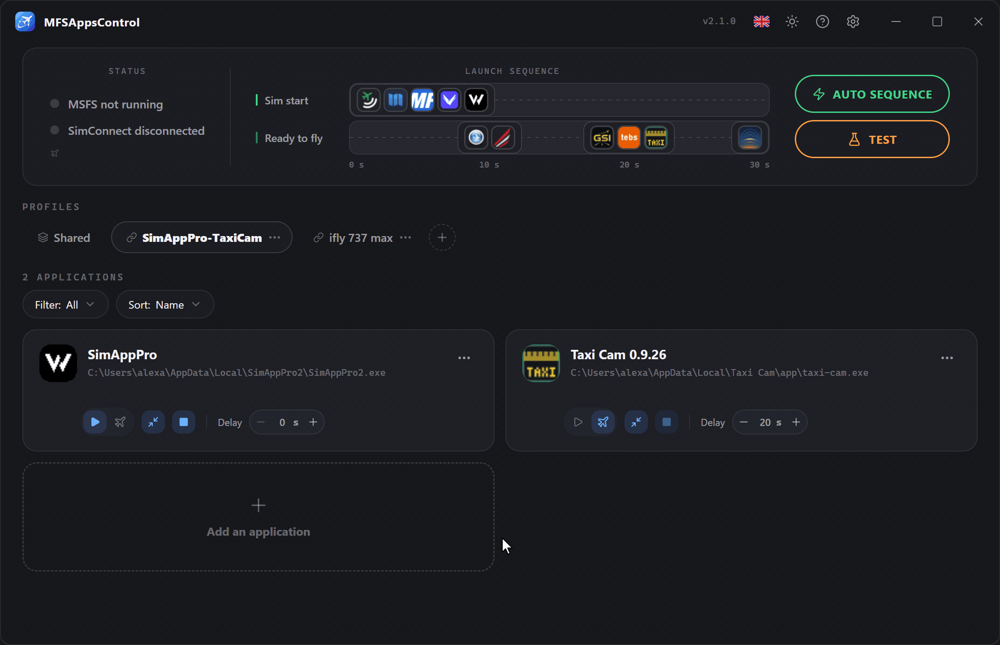
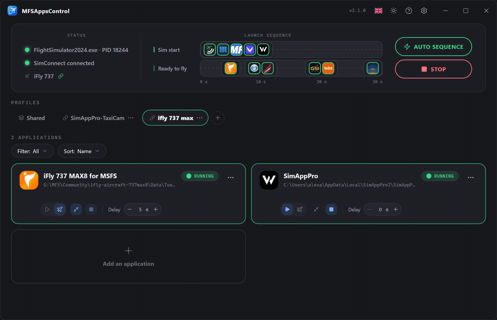
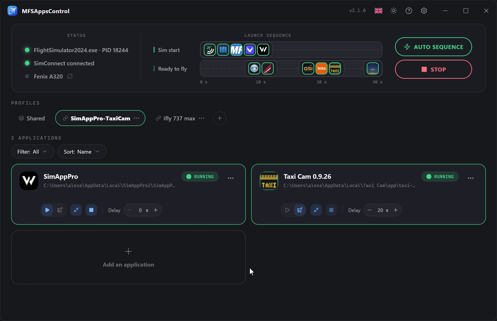
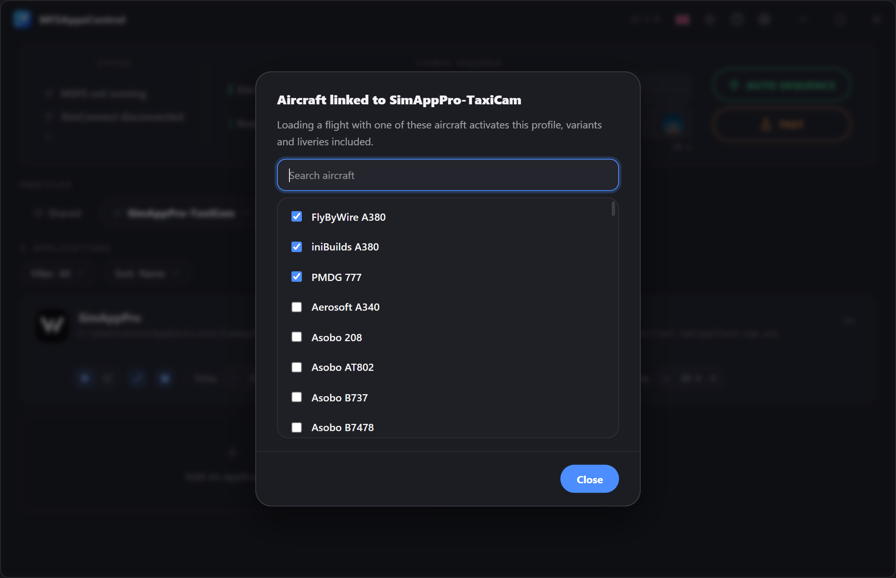

# Perfiles

Un **perfil** agrupa un conjunto de aplicaciones con sus ajustes. 
Crea varios según tus usos (vuelo en línea IFR, VFR, A320, A380…) y cambia de uno a otro con un clic.

!!! info "El perfil activo es el que dirige la secuencia"
    La secuencia ejecuta las aplicaciones del perfil **Compartido** y las del perfil **mostrado**. 
    Mientras el simulador está iniciado, el perfil en uso aparece con un borde **verde**.

## Crear un perfil

Haz clic en el botón **:material-plus-circle-outline:** a la derecha de las pestañas. 
Se crea un nuevo perfil vacío y se te pide que le pongas nombre.

!!! note "Nombre único y cancelación"
    Dos perfiles no pueden llamarse **igual**. 
    Mientras el nombre introducido ya esté en uso, el campo se vuelve **rojo** y la validación queda bloqueada. 
    Para **cancelar**, haz clic en la cruz **:material-close-circle:** o pulsa **Esc**.

## Menú contextual

Cada insignia de perfil tiene un menú accesible con **:material-dots-horizontal:** o con **clic derecho**.
Este menú permite **renombrar**, **eliminar** o **duplicar** el perfil, y elegir sus **aviones vinculados**. → [Perfiles vinculados a aviones](#perfiles-vinculados-a-aviones)

### Duplicar un perfil

Para partir de un perfil existente sin tener que reconfigurarlo todo.
Se crea una copia, con **todas sus aplicaciones y sus ajustes**, llamada «*nombre del perfil* (copia)», que hay que renombrar con un nombre único.

Sus **aviones vinculados** no se copian: un avión pertenece a un solo perfil.

### Renombrar un perfil

Al renombrar, el nombre debe ser **único**; mientras no lo sea, la validación quedará bloqueada.

### Eliminar un perfil

Eliminar un perfil es **irreversible** y borra **todas las aplicaciones y ajustes** que contiene. 
No se puede eliminar el último perfil disponible.

Sus vínculos con aviones se eliminan con él.

### Reordenar

**Arrastra y suelta** las insignias para cambiar su orden.
Es algo puramente visual, para que encuentres más fácilmente tus perfiles favoritos.

## El perfil Compartido

La pestaña **Compartido**, siempre la primera, contiene las aplicaciones que usas con **todos tus aviones** — Volanta, Navigraph, vPilot… 
Se configuran una sola vez, se inician con cualquier perfil activo y aparecen en la misma línea de tiempo.

- No se puede renombrar, duplicar, eliminar ni mover.
- Seleccionarla sola ejecuta solo sus aplicaciones.
- Una aplicación está en Compartido o en perfiles, nunca en ambos: la ventana de añadir explica por qué si lo intentas.

## Agrupar en Compartido

MFSAppsControl ofrece mover a Compartido las aplicaciones que varios perfiles tienen en común. **Nunca lo hace por su cuenta**: una ventana las lista, todas marcadas, y solo se mueve lo que dejas marcado.

La propuesta aparece:

- **una vez, tras la actualización a la 2.1**, para las aplicaciones presentes en todos tus perfiles;
- cuando **añades** una aplicación que otro perfil ya tiene;
- con **Mover a Compartido**, en el menú **:material-dots-horizontal:** de una tarjeta, cuando quieras;
- cuando añades a Compartido una aplicación que ya tienen algunos perfiles.

Dos entradas son la misma aplicación cuando tienen la **misma ruta y los mismos argumentos**. Si los perfiles no coinciden en sus ajustes, se conservan los más frecuentes, y el retardo conservado se muestra antes de confirmar.

## Perfiles vinculados a aviones

Un perfil puede **vincularse a uno o varios aviones**: cuando se carga un vuelo con uno de ellos, ese perfil se activa solo — pasar del A380 al 737 ya no obliga a cambiar de perfil a mano.

**Vincular un avión**

- **Desde el panel**: en cuanto el simulador anuncia el avión cargado, haz clic en su nombre y elige el perfil.
- **Desde el menú del perfil → Aviones vinculados…**: la lista de tus aviones instalados (Community y Marketplace), con un campo de búsqueda, utilizable con el simulador iniciado o no. Los aviones ya vinculados al perfil aparecen primero; un avión vinculado a otro perfil indica cuál lo tiene, y marcarlo lo trae aquí.

Un perfil vinculado muestra un icono :material-link-variant: en su insignia; pasa el ratón por encima para ver sus aviones.

**Conviene saber**

- Las **variantes y libreas** de un avión cuentan como un solo avión.
- Un avión pertenece a **un solo perfil**, y Compartido no se puede vincular.
- El cambio se produce **al cargar el vuelo**, nunca mientras recorres los aviones en el menú principal, y solo con la **secuencia automática** activada.
- Un avión desinstalado sigue en la lista mientras esté vinculado, para que puedas desvincularlo.

## Cambiar de perfil durante una sesión

Ya no se bloquea nada: los perfiles y las aplicaciones se pueden modificar en cualquier momento, también en vuelo. Solo una tarjeta cuyo retardo está en cuenta atrás queda bloqueada, hasta que termina o la cancelas.

Cuando cambias de perfil — a mano, o mediante un avión vinculado — **no pasa nada en el momento**. Al **cargar el siguiente vuelo**:

- las aplicaciones del perfil anterior que el nuevo no contiene **se cierran**;
- las aplicaciones **Inicio del sim** del nuevo perfil **arrancan enseguida**, sin su retardo;
- sus aplicaciones **Listo para volar** arrancan en la pantalla Listo para volar, con su retardo.

Las aplicaciones comunes a ambos perfiles, y las de Compartido, siguen funcionando.
