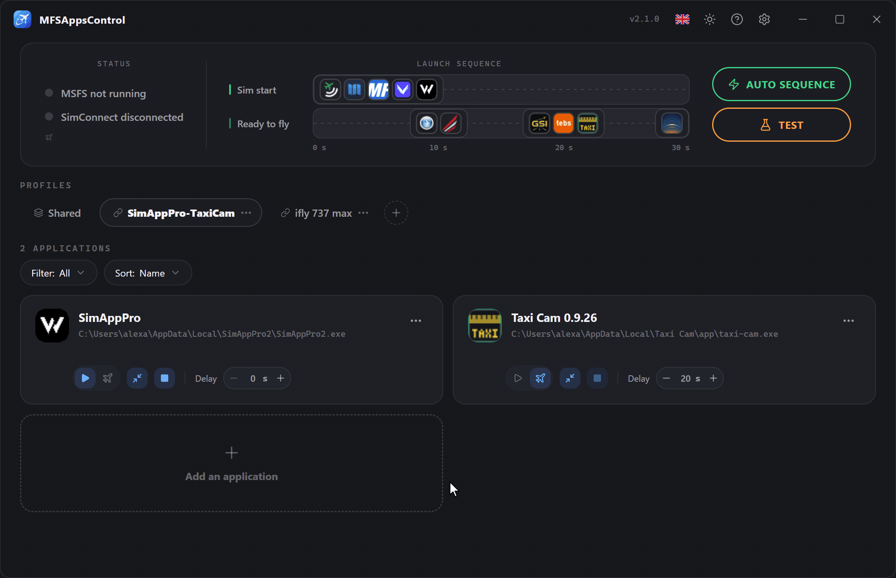
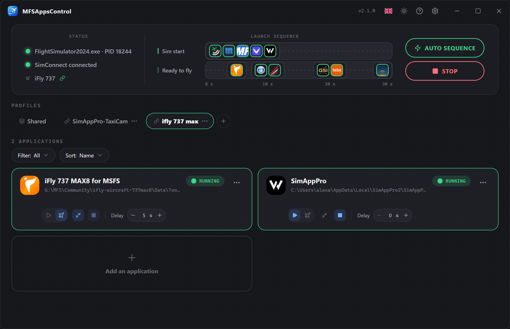
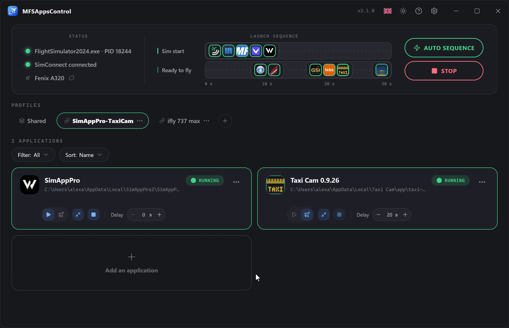
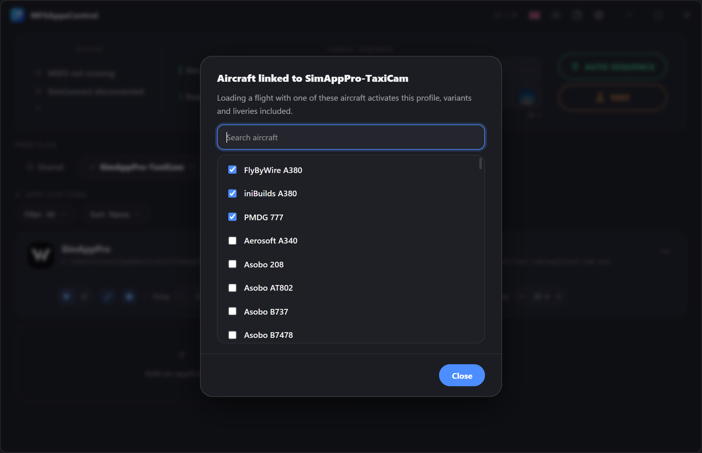

# Profils

Un **profil** regroupe un ensemble d'applications avec leurs réglages. 
Créez-en plusieurs selon vos usages (vol en ligne IFR, VFR, A320, A380…) et basculez de l'un à l'autre en un clic.

!!! info "Le profil actif est celui qui pilote la séquence"
    La séquence exécute les applications du profil **Partagé** et celles du profil **affiché**. 
    Lorsque le simulateur est lancé, le profil en cours d'utilisation est entouré en **vert**.

## Créer un profil

Cliquez sur le bouton **:material-plus-circle-outline:** à droite des onglets. 
Un nouveau profil vierge est créé et vous demande de le nommer.

!!! note "Nom unique et annulation"
    Deux profils ne peuvent pas porter le **même nom**. 
    Tant que le nom saisi est déjà utilisé, le champ devient **rouge** et la validation est bloquée. 
    Pour **annuler**, cliquez sur la croix **:material-close-circle:** ou appuyez sur **Échap**.

## Menu contextuel

Un menu est accessible sur chaque badge de profil via **:material-dots-horizontal:** ou un **clic droit**.
Ce menu permet de **renommer**, **supprimer** ou **dupliquer** le profil, et de choisir ses **avions liés**. → [Profils liés aux avions](#profils-lies-aux-avions)

### Dupliquer un profil

Pour repartir d'un profil existant sans devoir tout reconfigurer.
Une copie est créée, avec **toutes ses applications et leurs réglages**, nommée « *nom du profil* (dupliqué) » à renommer par un nom unique.

Ses **avions liés** ne sont pas copiés : un avion n'appartient qu'à un seul profil.

### Renommer un profil

Au renommage, le nom doit être **unique** et bloquera la validation tant que ce n'est pas le cas.

    

### Supprimer un profil

La suppression d'un profil est **irréversible** et supprime **toutes les applications et réglages** qu'il contient. 
Il n'est pas possible de supprimer le dernier profil disponible.

Ses liens avec des avions sont supprimés avec lui.

### Réorganiser

**Glissez-déposez** les badges pour changer leur ordre.
Cela est purement visuel pour vous permettre de retrouver vos profils favoris plus facilement.

## Le profil Partagé

L'onglet **Partagé**, toujours en premier, contient les applications que vous utilisez avec **tous vos avions** — Volanta, Navigraph, vPilot… 
Elles se règlent une seule fois, se lancent avec n'importe quel profil actif et figurent sur la même timeline.

- Il ne peut être ni renommé, ni dupliqué, ni supprimé, ni déplacé.
- Le sélectionner seul n'exécute que ses applications.
- Une application est soit dans Partagé, soit dans des profils, jamais les deux : la fenêtre d'ajout explique pourquoi si vous essayez.

## Regrouper dans Partagé

MFSAppsControl propose de déplacer dans Partagé les applications que plusieurs profils ont en commun. Il **ne le fait jamais de lui-même** : une fenêtre les liste, toutes cochées, et seul ce que vous laissez coché est déplacé.

La proposition arrive :

- **une fois, après la mise à jour vers la 2.1**, pour les applications présentes dans tous vos profils ;
- quand vous **ajoutez** une application qu'un autre profil contient déjà ;
- avec **Déplacer vers Partagé**, dans le menu **:material-dots-horizontal:** d'une carte, quand vous le souhaitez ;
- quand vous ajoutez à Partagé une application que des profils contiennent déjà.

Deux entrées sont la même application quand elles ont le **même chemin et les mêmes arguments**. Quand les profils ne s'accordent pas sur ses réglages, les plus fréquents sont retenus, et le délai retenu est affiché avant que vous confirmiez.

## Profils liés aux avions

Un profil peut être **lié à un ou plusieurs avions** : quand un vol se charge avec l'un d'eux, ce profil devient actif tout seul — passer de l'A380 au 737 ne demande plus de changer de profil à la main.

**Lier un avion**

- **Depuis le bandeau** : dès que le simulateur annonce l'avion chargé, cliquez sur son nom et choisissez le profil.
- **Depuis le menu du profil → Avions liés…** : la liste de vos avions installés (Community et Marketplace), avec un champ de recherche, utilisable simulateur lancé ou non. Les avions déjà liés au profil viennent en premier ; un avion lié ailleurs indique le profil qui le détient, et le cocher le déplace ici.

Un profil lié affiche une icône :material-link-variant: sur son badge ; survolez-la pour voir ses avions.

**Bon à savoir**

- Les **variantes et livrées** d'un avion comptent pour un seul avion.
- Un avion n'appartient qu'à **un seul profil**, et Partagé ne peut pas être lié.
- La bascule se fait **au chargement du vol**, jamais pendant que vous parcourez les avions au menu principal, et seulement si la **séquence automatique** est activée.
- Un avion désinstallé reste dans la liste tant qu'il est lié, pour que vous puissiez le délier.

## Changer de profil pendant une session

Plus rien n'est verrouillé : profils et applications se modifient à tout moment, en vol compris. Seule une carte dont le délai est en cours de décompte reste verrouillée, jusqu'à la fin du décompte ou son annulation.

Quand vous changez de profil — à la main, ou par un avion lié — **rien ne se passe sur le moment**. Au **chargement du vol suivant** :

- les applications de l'ancien profil que le nouveau ne contient pas **se ferment** ;
- les applications **Démarrage sim** du nouveau profil **partent tout de suite**, sans leur délai ;
- ses applications **Prêt à voler** partent à l'écran Prêt à voler, avec leur délai.

Les applications communes aux deux profils, et celles de Partagé, continuent de tourner.
