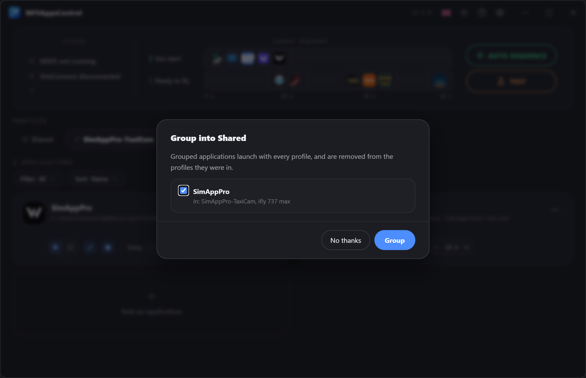
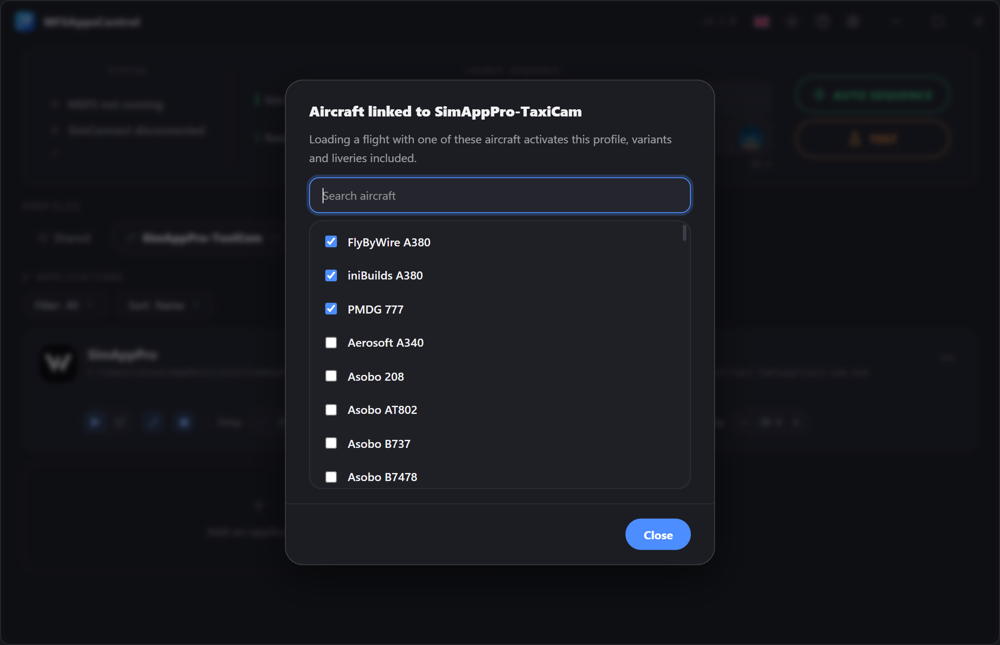

# Profili

Un **profilo** raggruppa un insieme di applicazioni con le loro impostazioni. 
Creane diversi in base ai tuoi usi (volo online IFR, VFR, A320, A380…) e passa dall'uno all'altro con un clic.

!!! info "Il profilo attivo è quello che comanda la sequenza"
    La sequenza esegue le applicazioni del profilo **Condiviso** e quelle del profilo **mostrato**. 
    Mentre il simulatore è avviato, il profilo in uso è bordato di **verde**.

## Creare un profilo

Fai clic sul pulsante **:material-plus-circle-outline:** a destra delle schede. 
Viene creato un nuovo profilo vuoto e ti viene chiesto di assegnargli un nome.

!!! note "Nome univoco e annullamento"
    Due profili non possono avere lo **stesso nome**. 
    Finché il nome inserito è già in uso, il campo diventa **rosso** e la conferma è bloccata. 
    Per **annullare**, fai clic sulla croce **:material-close-circle:** oppure premi **Esc**.

## Menu contestuale

Su ogni badge di profilo è disponibile un menu tramite **:material-dots-horizontal:** o un **clic destro**.
Questo menu permette di **rinominare**, **eliminare** o **duplicare** il profilo, e di scegliere i suoi **aerei collegati**. → [Profili collegati agli aerei](#profili-collegati-agli-aerei)

### Duplicare un profilo

Per ripartire da un profilo esistente senza dover riconfigurare tutto.
Viene creata una copia, con **tutte le sue applicazioni e le loro impostazioni**, chiamata « *nome del profilo* (copia) », da rinominare con un nome univoco.

I suoi **aerei collegati** non vengono copiati: un aereo appartiene a un solo profilo.

### Rinominare un profilo

Anche al momento della rinomina il nome deve essere **univoco**: finché non lo è, la conferma resta bloccata.

### Eliminare un profilo

L'eliminazione di un profilo è **irreversibile** ed elimina **tutte le applicazioni e le impostazioni** che contiene. 
Non è possibile eliminare l'ultimo profilo rimasto.

I suoi collegamenti con gli aerei vengono rimossi con lui.

### Riordinare

**Trascina** i badge per cambiarne l'ordine.
È puramente visivo e serve a ritrovare più facilmente i tuoi profili preferiti.

## Il profilo Condiviso

La scheda **Condiviso**, sempre per prima, contiene le applicazioni che usi con **tutti i tuoi aerei** — Volanta, Navigraph, vPilot… 
Si configurano una sola volta, si avviano con qualsiasi profilo attivo e compaiono sulla stessa timeline.

- Non può essere rinominato, duplicato, eliminato né spostato.
- Selezionarlo da solo esegue solo le sue applicazioni.
- Un'applicazione sta in Condiviso o nei profili, mai in entrambi: la finestra di aggiunta spiega il perché se ci provi.

## Raggruppare in Condiviso

MFSAppsControl propone di spostare in Condiviso le applicazioni che più profili hanno in comune. **Non lo fa mai da solo**: una finestra le elenca, tutte spuntate, e si sposta solo ciò che lasci spuntato.

La proposta arriva:

- **una volta, dopo l'aggiornamento alla 2.1**, per le applicazioni presenti in tutti i tuoi profili;
- quando **aggiungi** un'applicazione che un altro profilo ha già;
- con **Sposta in Condiviso**, nel menu **:material-dots-horizontal:** di una scheda, quando vuoi;
- quando aggiungi a Condiviso un'applicazione che alcuni profili hanno già.

Due voci sono la stessa applicazione quando hanno **lo stesso percorso e gli stessi argomenti**. Se i profili non concordano sulle sue impostazioni, si tengono le più frequenti, e il ritardo mantenuto è mostrato prima della conferma.

## Profili collegati agli aerei

Un profilo può essere **collegato a uno o più aerei**: quando si carica un volo con uno di essi, quel profilo si attiva da solo — passare dall'A380 al 737 non richiede più di cambiare profilo a mano.

**Collegare un aereo**

- **Dal banner**: appena il simulatore annuncia l'aereo caricato, fai clic sul suo nome e scegli il profilo.
- **Dal menu del profilo → Aerei collegati…**: l'elenco dei tuoi aerei installati (Community e Marketplace), con un campo di ricerca, utilizzabile con il simulatore avviato o no. Gli aerei già collegati al profilo vengono per primi; un aereo collegato altrove indica quale profilo lo ha, e spuntarlo lo sposta qui.

Un profilo collegato mostra un'icona :material-link-variant: sul suo badge; passaci sopra per vedere i suoi aerei.

**Buono a sapersi**

- Le **varianti e le livree** di un aereo contano come un solo aereo.
- Un aereo appartiene a **un solo profilo**, e Condiviso non può essere collegato.
- Il cambio avviene **al caricamento del volo**, mai mentre sfogli gli aerei nel menu principale, e solo con la **sequenza automatica** attiva.
- Un aereo disinstallato resta nell'elenco finché è collegato, così puoi scollegarlo.

## Cambiare profilo durante una sessione

Non si blocca più nulla: profili e applicazioni si modificano in qualsiasi momento, anche in volo. Solo una scheda il cui ritardo è in conto alla rovescia resta bloccata, finché il conto non termina o lo annulli.

Quando cambi profilo — a mano, o tramite un aereo collegato — **sul momento non succede nulla**. Al **caricamento del volo successivo**:

- le applicazioni del profilo precedente che il nuovo non contiene **si chiudono**;
- le applicazioni **Avvio sim** del nuovo profilo **partono subito**, senza il loro ritardo;
- le sue applicazioni **Pronto al volo** partono alla schermata Pronto al volo, con il loro ritardo.

Le applicazioni comuni ai due profili, e quelle di Condiviso, continuano a funzionare.
