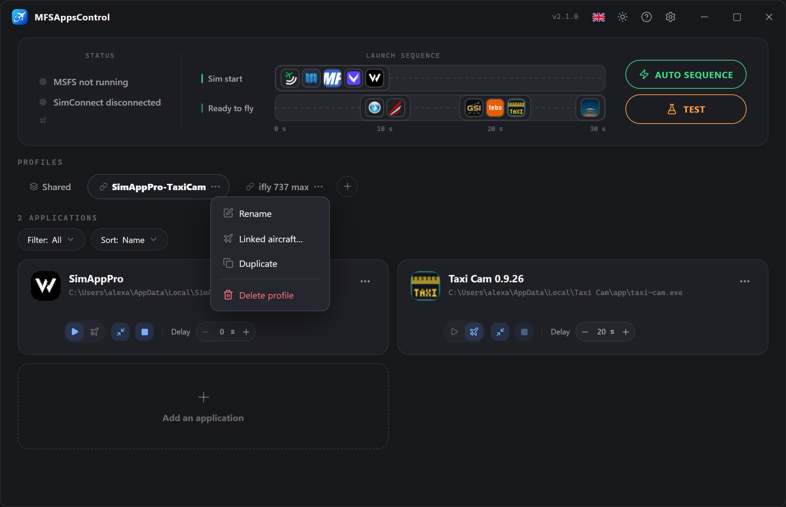
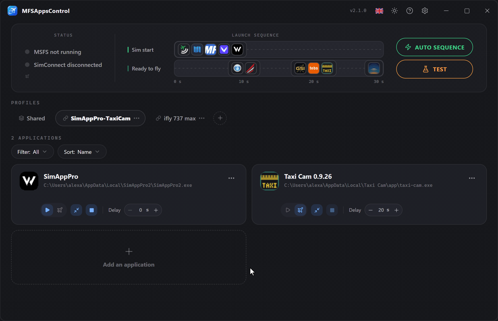
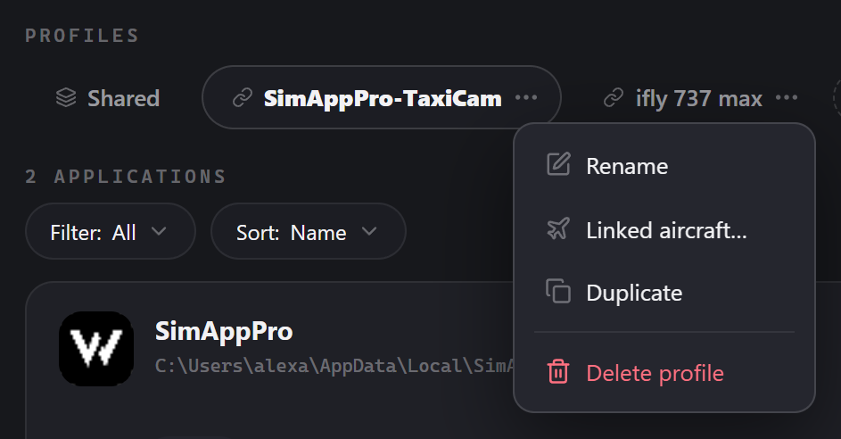
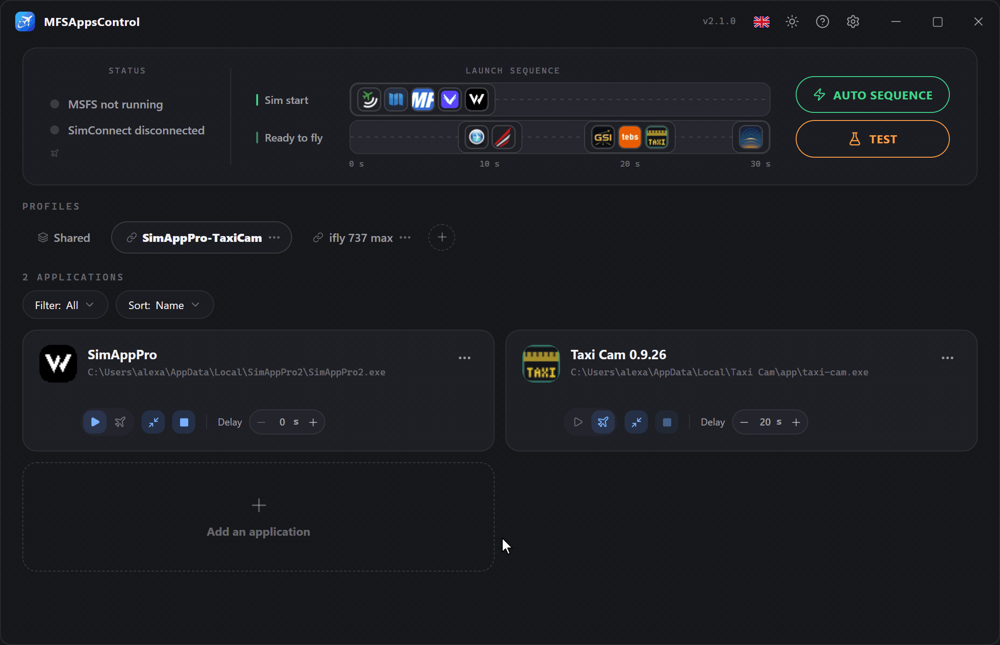
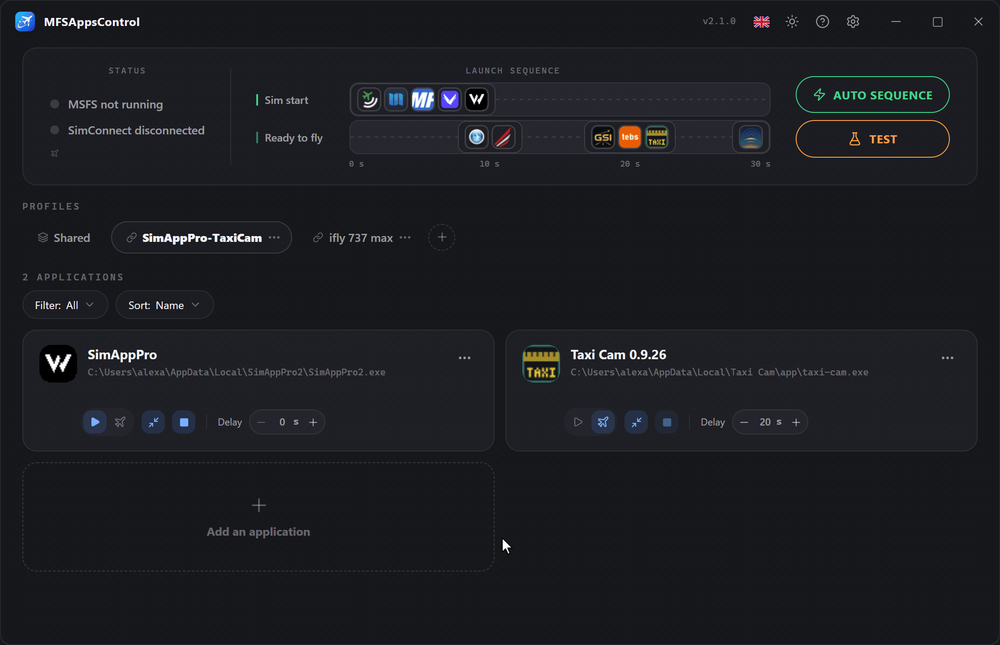
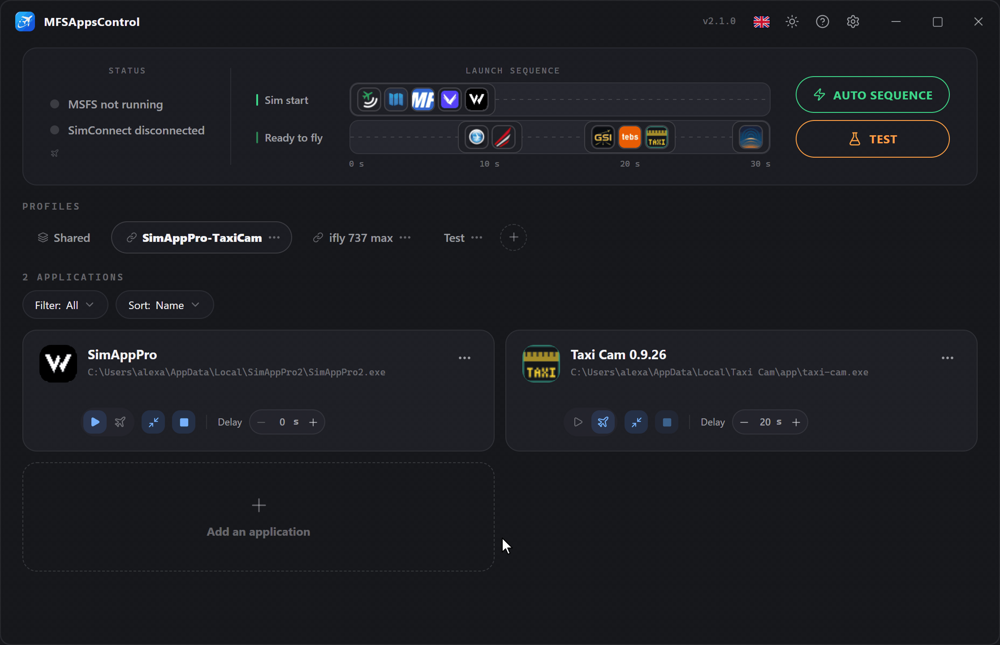
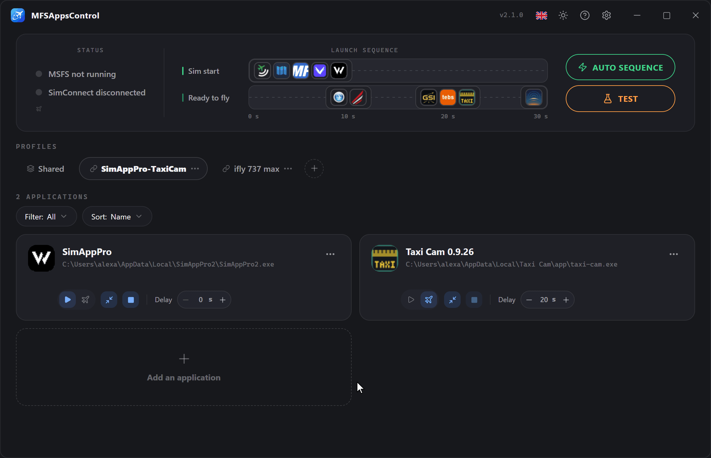

# Profiles

A **profile** groups a set of applications together with their settings. 
Create as many as you have use cases (online IFR flying, VFR, A320, A380…) and switch from one to another with a single click.

!!! info "The active profile is the one that drives the sequence"
    The sequence runs the applications of the **Shared** profile plus those of the profile **shown**. 
    While the simulator is running, the profile in use is outlined in **green**.

## Creating a profile

Click the **:material-plus-circle-outline:** button to the right of the tabs. 
A new empty profile is created and asks you to name it.

!!! note "Unique name and canceling"
    Two profiles cannot have the **same name**. 
    As long as the name you type is already in use, the field turns **red** and confirmation is blocked. 
    To **cancel**, click the **:material-close-circle:** cross or press **Esc**.

## Context menu

A menu is available on every profile badge, through **:material-dots-horizontal:** or a **right-click**.
It lets you **rename**, **delete** or **duplicate** the profile, and choose its **linked aircraft**. → [Profiles linked to aircraft](#profiles-linked-to-aircraft)

### Duplicating a profile

To start from an existing profile without reconfiguring everything.
A copy is created with **all its applications and their settings**, named "*profile name* (copy)", ready to be renamed to a unique name.

Its **linked aircraft** are not copied: an aircraft belongs to a single profile.

### Renaming a profile

When renaming, the name has to be **unique**; confirmation stays blocked until it is.

    

### Deleting a profile

Deleting a profile is **irreversible** and removes **all the applications and settings** it contains. 
The last remaining profile cannot be deleted.

Its aircraft links are removed with it.

### Reordering

**Drag and drop** the badges to change their order.
This is purely visual, so you can find your favorite profiles more easily.

## The Shared profile

The **Shared** tab, always first, holds the applications you use with **every aircraft** — Volanta, Navigraph, vPilot… 
They are set up once, launch with whichever profile is active, and appear on the same timeline.

- It cannot be renamed, duplicated, deleted or moved.
- Selecting it on its own runs only its applications.
- An application is either in Shared or in profiles, never both: the add window explains why when you try.

## Grouping into Shared

MFSAppsControl offers to move into Shared the applications that several profiles have in common. It **never does so on its own**: a window lists them, all ticked, and only what you leave ticked moves.

The offer comes:

- **once, after the update to 2.1**, for the applications that all your profiles hold;
- when you **add** an application that another profile already has;
- from **Move to Shared**, in a card's **:material-dots-horizontal:** menu, whenever you like;
- when you add to Shared an application that profiles already have.

Two entries are the same application when they have the **same path and the same arguments**. When the profiles disagree on its settings, the most common ones are kept, and the delay kept is shown before you confirm.

## Profiles linked to aircraft

A profile can be **linked to one or more aircraft**: when a flight loads with one of them, that profile becomes active by itself — going from the A380 to the 737 no longer means switching profile by hand.

**Linking an aircraft**

- **From the banner**: once the simulator reports the loaded aircraft, click its name and choose the profile.
- **From the profile menu → Linked aircraft…**: the list of your installed aircraft (Community and Marketplace), with a search field, usable with the simulator running or not. The aircraft already linked to the profile come first; one linked elsewhere shows which profile holds it, and ticking it moves it here.

A linked profile shows a :material-link-variant: icon on its badge; hover it to see its aircraft.

**Good to know**

- The **variants and liveries** of an aircraft count as a single aircraft.
- An aircraft belongs to **one profile** only, and Shared cannot be linked.
- The switch happens **when the flight loads**, never while you browse aircraft at the main menu, and only when the **automatic sequence** is on.
- An aircraft you have uninstalled stays in the list as long as it is linked, so that you can unlink it.

## Changing profile during a session

Nothing is locked any more: profiles and applications can be edited at any time, in flight too. Only a card whose delay is counting down stays locked until the countdown ends or you cancel it.

When you change profile — by hand, or through a linked aircraft — **nothing happens on the spot**. When the **next flight loads**:

- the applications of the previous profile that the new one does not hold **close**;
- the new profile's **Sim start** applications **start right away**, their delay skipped;
- its **Ready to fly** applications start at the Ready to fly screen, with their delay.

The applications both profiles share, and those of Shared, keep running.
