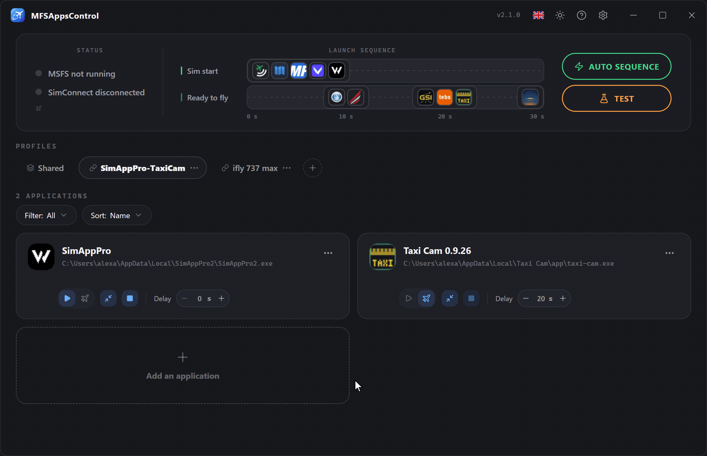
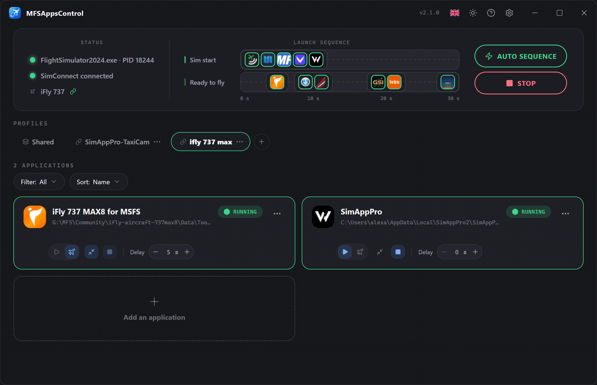
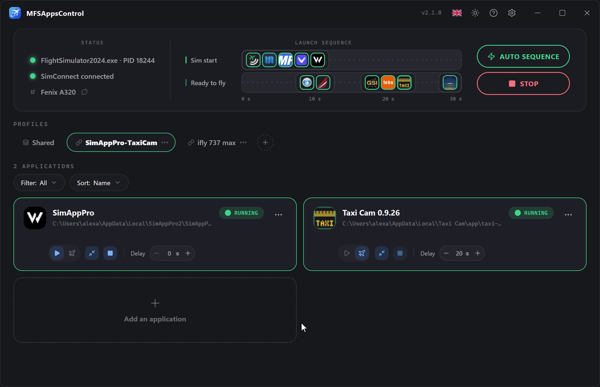
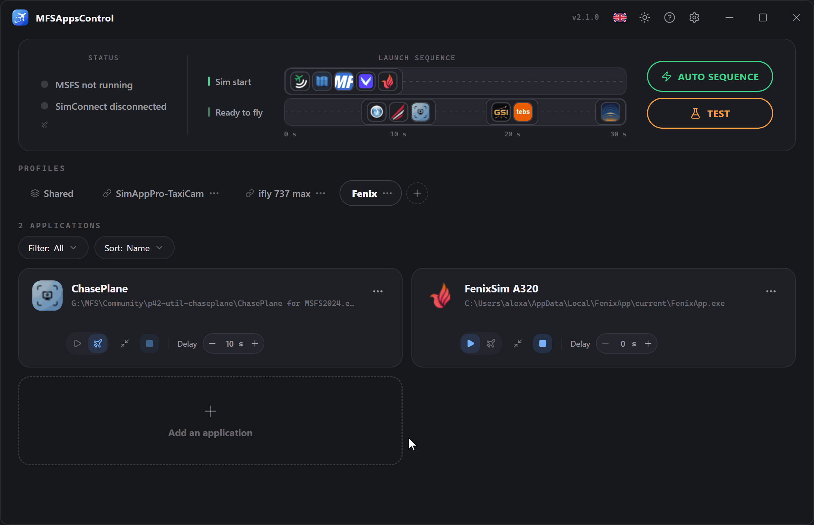

# Perfis

Um **perfil** agrupa um conjunto de aplicações com as suas definições. 
Crie vários conforme as suas utilizações (voo online IFR, VFR, A320, A380…) e alterne entre eles com um clique.

!!! info "O perfil ativo é o que comanda a sequência"
    A sequência executa as aplicações do perfil **Compartilhado** e as do perfil **apresentado**. 
    Enquanto o simulador está iniciado, o perfil em utilização tem um contorno **verde**.

## Criar um perfil

Clique no botão **:material-plus-circle-outline:** à direita dos separadores. 
É criado um novo perfil vazio e é-lhe pedido que o nomeie.

!!! note "Nome único e cancelamento"
    Dois perfis não podem ter o **mesmo nome**. 
    Enquanto o nome introduzido já estiver em uso, o campo fica **vermelho** e a validação fica bloqueada. 
    Para **cancelar**, clique na cruz **:material-close-circle:** ou prima **Esc**.

## Menu contextual

Está disponível um menu em cada emblema de perfil, através de **:material-dots-horizontal:** ou de um **clique com o botão direito**.
Este menu permite **mudar o nome**, **eliminar** ou **duplicar** o perfil, e escolher as suas **aeronaves vinculadas**. → [Perfis vinculados a aeronaves](#perfis-vinculados-a-aeronaves)

### Duplicar um perfil

Para partir de um perfil existente sem ter de reconfigurar tudo.
É criada uma cópia, com **todas as suas aplicações e as respetivas definições**, chamada «*nome do perfil* (cópia)», que deve renomear com um nome único.

As suas **aeronaves vinculadas** não são copiadas: uma aeronave pertence a um único perfil.

### Mudar o nome de um perfil

Ao mudar o nome, este tem de ser **único** e bloqueará a validação enquanto não o for.

### Eliminar um perfil

A eliminação de um perfil é **irreversível** e apaga **todas as aplicações e definições** que ele contém. 
Não é possível eliminar o último perfil disponível.

As suas ligações a aeronaves são removidas com ele.

### Reordenar

**Arraste e largue** os emblemas para mudar a sua ordem.
Isto é puramente visual, para o ajudar a encontrar mais facilmente os seus perfis preferidos.

## O perfil Compartilhado

O separador **Compartilhado**, sempre em primeiro lugar, contém as aplicações que utiliza com **todas as suas aeronaves** — Volanta, Navigraph, vPilot… 
Configuram-se uma única vez, iniciam com qualquer perfil ativo e aparecem na mesma linha temporal.

- Não pode mudar de nome, ser duplicado, eliminado nem deslocado.
- Selecioná-lo sozinho executa apenas as suas aplicações.
- Uma aplicação está em Compartilhado ou em perfis, nunca nos dois: a janela de adição explica porquê se tentar.

## Agrupar em Compartilhado

O MFSAppsControl propõe mover para Compartilhado as aplicações que vários perfis têm em comum. **Nunca o faz sozinho**: uma janela lista-as, todas assinaladas, e só se move o que deixar assinalado.

A proposta surge:

- **uma vez, após a atualização para a 2.1**, para as aplicações presentes em todos os seus perfis;
- quando **adiciona** uma aplicação que outro perfil já tem;
- com **Mover para Compartilhado**, no menu **:material-dots-horizontal:** de um cartão, quando quiser;
- quando adiciona a Compartilhado uma aplicação que alguns perfis já têm.

Duas entradas são a mesma aplicação quando têm o **mesmo caminho e os mesmos argumentos**. Se os perfis não estiverem de acordo sobre as suas definições, mantêm-se as mais frequentes, e o atraso mantido é apresentado antes de confirmar.

## Perfis vinculados a aeronaves

Um perfil pode ser **vinculado a uma ou mais aeronaves**: quando um voo é carregado com uma delas, esse perfil fica ativo sozinho — passar do A380 para o 737 deixa de exigir uma mudança de perfil à mão.

**Vincular uma aeronave**

- **A partir do painel**: assim que o simulador anuncia a aeronave carregada, clique no nome e escolha o perfil.
- **A partir do menu do perfil → Aeronaves vinculadas…**: a lista das suas aeronaves instaladas (Community e Marketplace), com um campo de pesquisa, utilizável com o simulador iniciado ou não. As aeronaves já vinculadas ao perfil aparecem primeiro; uma aeronave vinculada a outro perfil indica qual a tem, e assinalá-la traz-la para aqui.

Um perfil vinculado mostra um ícone :material-link-variant: no seu emblema; passe o rato por cima para ver as suas aeronaves.

**É bom saber**

- As **variantes e pinturas** de uma aeronave contam como uma única aeronave.
- Uma aeronave pertence a **um único perfil**, e Compartilhado não pode ser vinculado.
- A mudança acontece **ao carregar o voo**, nunca enquanto percorre as aeronaves no menu principal, e só com a **sequência automática** ativa.
- Uma aeronave desinstalada fica na lista enquanto estiver vinculada, para que a possa desvincular.

## Mudar de perfil durante uma sessão

Já nada fica bloqueado: perfis e aplicações podem ser editados a qualquer momento, também em voo. Só um cartão cujo atraso está em contagem fica bloqueado, até a contagem terminar ou a cancelar.

Quando muda de perfil — à mão, ou através de uma aeronave vinculada — **nada acontece no momento**. Ao **carregar o voo seguinte**:

- as aplicações do perfil anterior que o novo não contém **fecham-se**;
- as aplicações **Início do sim** do novo perfil **arrancam de imediato**, sem o seu atraso;
- as suas aplicações **Pronto para voar** arrancam no ecrã Pronto para voar, com o seu atraso.

As aplicações comuns aos dois perfis, e as de Compartilhado, continuam a funcionar.
